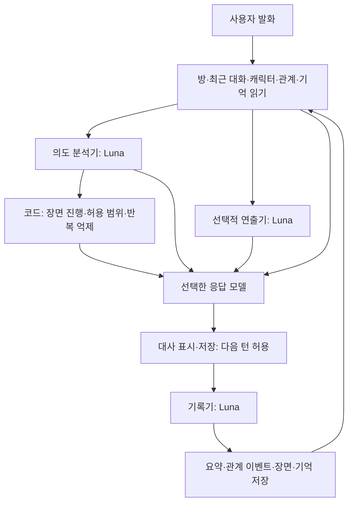

# 캐릭터 발화 구조 감사

기준: 2026-11-06, 현재 작업 공간 코드. 운영 동작 변경 없이 작성한 보고서다.

후속 안내: 아래는 수정 전 감사 기록이다. 이후 확정된 단일 대화방 정책과 구현 결과는 [컴패니언 엔진 변경 기록](./lounge-companion-engine-update.md)을 따른다.

**판정: 네 요소는 모두 구현되어 있지만, 하나의 상황 이해로 연결되어 있다는 보장이 부족하다. 가장 먼저 고칠 것은 바이블 분량이 아니라 공통 규칙의 충돌, 계층 사이 입력 차이, 상태의 수명과 저장 순서다. 모델의 대화 능력도 영향을 주지만 현재 구조로는 그 영향을 분리해 측정하기 어렵다.**

검사 범위는 캐릭터 등록과 프롬프트 조립, 의도 분석, 연출, 장면 결정, 관계 엔진, 기억 검색과 기록, 스트리밍과 후처리, 관련 SQL과 테스트다. 실제 회원 대화, 운영 환경변수, 배포 로그, 운영 DB의 마이그레이션 적용 상태는 확인하지 않았다. 따라서 아래의 코드상 결함과 실제 서비스에서의 발생 빈도는 구분해야 한다. 모델 이름은 저장소에 설정된 ID를 그대로 사용했다.

## 1. 실제 발화 경로

일반적인 1:1 스트리밍 채팅의 새 사용자 발화는 다음 경로를 지난다. 첫 인사, 전화, 다인 대화, 상담 등에는 분기가 있다.



- 캐릭터: `loungePersonaPrompt` + `loungeBiblePrompt` + `loungeCompanionSheetPrompt`.
- 관계: `relationshipPromptContext` + 시나리오 보정 + `loungeTurnConditions`.
- 의도: `loungeAnalyzerInput` → `reading`. 장면 전환·거절·수습 여부는 코드에도 전달한다.
- 연출: 별도 director가 반응 유형·목적·끝맺음을 정한다. 분석기와 병렬이며 분석 결과를 받지 않는다.
- 생성: 선택한 모델이 대사와 필요한 속마음을 JSON으로 작성한다.
- 기록: 대사를 저장한 뒤 다른 호출이 요약, 관계 이벤트, 장면, 남은 감정, 장기 기억 연산을 작성한다.

근거: [API의 분석·연출 경로](../api/lounge.ts#L768), [응답 요청 조립](../api/lounge.ts#L1075), [후처리](../api/lounge.ts#L1216), [대사 저장 후 다음 턴 허용](../api/lounge.ts#L1764).

현재 빠른 기본 채팅은 정상 시 분석·연출·생성·기록의 **4회 LLM 호출**이다. Sol/Terra는 기본 설정에서 director가 없어 보통 3회다. 사진·상담·재시도·임베딩 요청은 이 수에 포함하지 않았다. 기능이 빠진 단일 프롬프트 구조로 볼 수는 없다.

## 2. 요청한 네 요소의 연결 상태

| 요소 | 구현된 것 | 연결의 약점 | 판정 |
|---|---|---|---|
| 인물 정체성 | 프로필, 성격, 바이블, 해석 관점, 예시, 관계 설정의 core/hints | 여러 위치에 중복되고 공통 관계 지침과 충돌 | 존재하지만 우선순위 정리 필요 |
| 현재 관계·장면 | 구조화 scene, 단계·기분·점수, 최근 대화, 요약, 시나리오 | 단계가 장면별 판단까지 강제하고, 장면 갱신이 다음 턴보다 늦을 수 있음 | 부분적으로 유기적 |
| 발화 의도 | 농담·진심의 복수 해석, 실제 부탁, 거절, 정정, 과거 언급 분석 | 최신 발화 절단, 서로 다른 기억, 독립적인 director 판단 | 핵심 통합 지점이 취약 |
| 기억·관계 변화 | 의미 검색, memory_ops, 결정론적 점수, lingering/next_intent | 역할극 사건의 영속 기억 부족, 방별 상태 공유, 후처리 실패·순서 경쟁 | 저장은 있으나 연속성 보장 부족 |

좋은 기반도 분명하다. 장면을 요약과 분리했고, 진심의 거절을 최우선 처리하며, 불만·정정을 지루함과 구별한다. 관계점수를 LLM이 직접 임의로 바꾸지 않고 이벤트로 계산한다. 방 요약에는 턴 역행 방지가 있고, 장기 기억의 실제 사용자 정보와 역할 정보도 구별하려 한다. 이 기반을 유지하면서 단순화할 수 있다.

## 3. 우선 해결할 문제

### A. 서도현의 고유 반응과 공통 첫 단계 규칙이 실제로 충돌한다 — 확정

서도현의 첫 단계 로맨스 설정은 다음과 같다.

> 상대가 플러팅하면 같은 수위로 능청스럽게 받되 관계를 앞서가지 않는다.

그러나 공통 `relationshipFirstStageReserve`에는 다음 내용이 있다.

> 상대가 먼저 호감을 보이거나 플러팅해도 반가워하며 받아 주지 않는다.

공통 규칙은 당황하거나 의아해하며 거리를 유지하라고도 하며, 명시적으로 `stage.hint`, `stage.romance`보다 우선한다. 서도현에는 전용 `firstStageReserve`가 없어 이 공통값이 들어간다. 선우령에는 이미 별도의 reserve가 있다.

따라서 바이블에 자신감·능청스러움을 추가해도 반대 지시가 다른 경로에서 들어온다. 이것은 모델 성능을 추측하지 않고 확인 가능한 입력 충돌이다. 다만 각 실제 응답에서 어느 문구가 얼마나 영향을 줬는지는 별도 실험이 필요하다.

근거: [서도현 고유 지침](../src/lib/relationship/configs/auditor.ts#L68), [공통 reserve](../src/lib/relationship/engine.ts#L363), [기본값 적용](../src/lib/relationship/engine.ts#L443), [선우령 전용 reserve](../src/lib/relationship/configs/velvetKnife.ts#L71).

**개선:** 공통 관계 단계는 감정 공개와 접근 범위만 표현하고, 당황·의아함·능청스러움 같은 반응 방식은 인물 정체성에 맡긴다. 캐릭터마다 예외 문구를 계속 추가하면 같은 문제가 반복된다.

### B. 관계 점수가 상황에 맞는 자연스러운 행동까지 막는다 — 확정

공통 첫 단계 `outing`은 함께 어디를 가거나 무엇을 하자는 제안을 받지 않도록 한다. 첫 맞선에서 식사 후 잠깐 걷는 것까지 같은 제한을 받는다. 시나리오 보정은 윤지안과 특정 강무진 이야기 등에 별도 분기로 구현돼 있지만 서도현에는 해당 보정이 없다.

근거: [첫 단계 outing](../src/lib/relationship/engine.ts#L365), [시나리오별 예외](../src/lib/loungeScenarios.ts#L28).

**개선:** 이미 합의한 관계·일정·장면은 사실로 유지한다. 관계 점수는 신뢰와 감정 표현의 정도를 보조하고, 모든 활동 수락 여부를 결정하는 단일 문으로 쓰지 않는다. 식사·짧은 산책과 관계 확정·새로운 접촉 동의는 별도로 판단한다.

### C. 한 턴에 서로 다른 해석이 동시에 들어온다 — 배선은 확정, 오독 빈도는 미측정

| 입력 | 분석기 | 연출기 | 생성기 |
|---|---|---|---|
| 인물 | 이름·나이·직업 | 인물 요약·바이블 | 프로필·바이블·시트·관계 core |
| 최근 대화 | 8개, 메시지당 최대 약 400자 | 8개, 메시지당 최대 약 400자 | 채팅 16개, 별도 축약 |
| 장기 기억 | 중요도 기반 최대 6개 | 직접 전달 없음 | 의미 검색 반영 시 최대 8개 |
| 분석 결과 reading | 자신이 생성 | 받지 않음 | 받음 |
| 남은 감정·다음 의도 | 별도 carry 전달 없음 | 받음 | turn을 통해 받음 |

분석기와 director의 scenario는 id·사용자 역할·관계·장소만 남기고 프롤로그는 제외한다. 프롤로그에만 있는 중요한 출발 사실이 별도 현재 사실로 추출되지 않았다면 생성기와 보조 계층이 아는 사실도 달라진다. [보조 계층의 시나리오 축약](../src/lib/loungeMessenger.ts#L135)

분석기가 “농담 반 진심 반”이라고 읽는 동안 director는 별도로 “경계하며 해명” 같은 방향을 정할 수 있다. 최종 생성기는 두 값을 모두 조정해야 한다. `direction` 충돌 지침은 recent/turn을 우선하라고 하지만 reading과의 관계를 직접 정리하지 않는다. 후처리에는 reading과 같은 방향으로 관계 이벤트를 판정하라고 하므로, 최초 해석의 오류가 관계 변화로 이어질 수도 있다.

분석기가 바이블 전체를 받지 않는 것 자체는 결함이 아니다. 사용자의 의도는 먼저 중립적으로 읽고, 그 의도에 대한 캐릭터의 반응은 생성기가 정하는 구분은 타당하다. 현재 문제는 director가 또 하나의 독립적인 해석과 반응 지시를 만든다는 점이다.

근거: [분석기 입력](../api/lounge.ts#L774), [director 입력](../api/lounge.ts#L798), [병렬 실행](../api/lounge.ts#L1008), [생성기 통합](../api/lounge.ts#L1105), [기록기의 reading 재사용](../api/lounge.ts#L1129), [direction 우선순위](../src/lib/loungeMessenger.ts#L537).

**개선:** 매 턴 공통 상황 자료를 한 번 구성한다. 독립 director는 제거 후보로 두고, 필요한 경우 분석과 연출을 한 호출의 짧은 판단으로 통합한다. 하나의 충분한 생성 모델이 같은 자료에서 직접 해석하고 발화하는 2호출 구조와 비교한다. 호출 수 감소가 품질 개선을 보장하는 것은 아니므로 평가로 결정한다.

### D. 사용자의 최신 발화에서 핵심 부분이 분석 전에 삭제된다 — 순수 함수로 재현

분석기와 director는 400자가 넘는 메시지를 앞 200자와 뒤 197자로 줄인다. 최신 발화 `latest`도 이 절단본에서 가져온다. 생성기는 최근 두 사용자 메시지를 앞에서 최대 1,200자까지 받으므로 최신 발화 보존 정책마저 다르다.

순수 함수 검사에서 446자 최신 발화 중간에 넣은 `THIS_IS_SERIOUS_NOT_A_JOKE`가 분석기 `latest`에서 사라지는 것을 확인했다. 사용자가 중간에 “이건 장난이 아니라 진짜 서운해서 묻는 거예요”를 써도 같은 위치면 해석 입력에서 빠질 수 있다.

근거: [분석기 절단](../src/lib/loungeMessenger.ts#L157), [director 절단](../src/lib/loungeMessenger.ts#L528), [생성기 절단](../api/lounge.ts#L897).

**개선:** 허용된 최신 사용자 메시지 원문은 보존한다. 예산이 부족하면 오래된 메시지부터 축약한다. 긴 입력에 대한 제한도 계층마다 동일하게 적용하고, 핵심 조건을 조용히 잘라내지 않는다.

### E. 대사는 최신인데 상태는 과거인 턴이 가능하다 — 확정된 실행 순서, 운영 빈도 미측정

대사 저장 완료 이벤트가 오면 프런트는 다음 턴을 허용한다. 기록기 LLM 호출의 제한은 40초이고, 저장·임베딩은 그 뒤 별도로 실행된다. 사용자가 빨리 답하면 최신 대화는 recent에 있지만 scene·기분·관계는 이전 값일 수 있다. 후처리 호출이 실패하면 대사는 유지되지만 이번 턴의 새 장면·감정·기억이 빠질 수 있다.

또한 `saveCompanion`은 요청 초기에 읽은 상태로 새 값을 만들고 버전 없는 upsert를 한다. 늦게 끝난 이전 턴이 최신 장면을 덮어쓸 수 있다. 방 요약에는 `memory_turn`, 관계에는 `expected_version` 보호가 있으므로 모든 저장이 무방비인 것은 아니다. 다만 관계 버전 충돌도 경고 후 종료되어 재적용 보장이 없다.

근거: [대사와 후처리 분리](../api/lounge.ts#L1764), [화면의 release](../src/components/LoungePage.tsx#L1210), [후처리 실패 처리](../api/lounge.ts#L1216), [버전 없는 장면 저장](../api/lounge.ts#L1153), [요약 역행 방지](../supabase/migrations/20261105000000_lounge_reply_split.sql#L59), [관계 버전 저장](../api/lounge.ts#L1278).

**개선:** 상태에 room/turn/version을 붙이고, 처리할 턴 기록을 내구성 있게 남긴다. 장면 최신값은 오래된 쓰기를 거절하고, 누적 관계 이벤트는 턴 ID로 중복 없이 순서대로 적용한다. 다음 턴에는 아직 상태에 반영되지 않은 직전 대사·변경 사항을 포함하거나, 최소 상태 확정까지 기다리게 한다. 후처리 전체 40초를 사용자가 기다리게 할 필요는 없다.

### F. 같은 캐릭터의 여러 방이 하나의 장면 상태 행을 공유한다 — 순수 함수로 재현

companion 테이블 기본키는 `(user_id, character_id)`다. 하지만 내부 상태는 room_id가 다르면 대부분 초기화된다. A방을 하다가 같은 캐릭터의 B방에서 상태가 저장된 뒤 A방의 다음 턴을 생성하면 A방의 구조화 장면과 공유 경험을 유지할 슬롯이 없다. A→B→A 정규화 검사에서 scene, shared, self_facts 소실을 확인했다. 대화 원문과 방 요약까지 삭제된다는 뜻은 아니다.

근거: [기본키](../supabase/migrations/20261203000000_lounge_companion_state.sql#L14), [방 변경 시 초기화](../src/lib/loungeMessenger.ts#L213).

**개선:** 장면·감정·진행 중인 이야기는 방 또는 이야기 ID별로 저장한다. 캐릭터와의 전역 관계 및 다시 발생하지 않을 이벤트 기록은 별도로 유지한다. “처음부터”의 의도적 초기화와 다른 방을 잠깐 이용한 상황을 구별해야 한다.

### G. 이야기 속 약속을 오래 보존할 곳이 부족하다 — 정책은 확정

시나리오에서는 장기 `memory_ops`에 실제 사용자 정보만 기록하고 역할의 행동·사건·대사를 넣지 않도록 한다. 현실 정보와 역할 정보가 섞이지 않게 하려는 목적은 타당하다. 그러나 이야기 사건은 주로 다음 저장소에 남는다.

- 방 요약: 후처리 지침상 600자. 저장 RPC 코드의 상한은 1,800자다.
- companion.shared: 최근 12개.
- companion.self_facts: 최근 20개. 검증된 인물 설정이 아니라 과거 자기 발언 기록이다.
- 별도의 관계 이벤트 기억과 선택적으로 켜지는 에피소드 상태.

에피소드 기능은 현재 코드 기본값이 off이고 환경변수로 켤 수 있다. 따라서 에피소드 사실 기록이 모든 일반 채팅의 누락을 메운다고 볼 수 없다. [기본 설정](../src/lib/loungeStory.ts#L17), [API 조건](../api/lounge.ts#L830)

말투 합의, 계약의 변경 사항, 반복된 서운함의 원인이 짧은 요약에서 빠지고 최근 대화 범위를 벗어나면 원문을 찾아 복구하는 일반적인 이야기 기억 경로가 약하다. 구조화 scene은 장소·활동·시간·물건 위주여서 누가 곁에 있는지, 누구에게 비밀인지, 어떤 약속이 유효한지까지 별도 사실로 보장하지 않는다. 감정도 점수·기분과 한 줄 lingering으로 표현되어 사건별 맥락이 빠질 수 있다.

근거: [역할극 장기 기억 정책](../src/lib/relationship/memory.ts#L174), [요약 지침](../api/lounge.ts#L1126), [요약 저장 상한](../supabase/migrations/20261105000000_lounge_reply_split.sql#L66), [보존 개수](../src/lib/loungeMessenger.ts#L434), [scene 형태](../src/lib/loungeMessenger.ts#L179).

**개선:** 요약을 늘리기 전에 `확정 사실 / 유효한 합의·약속 / 미해결 사건`의 짧은 목록을 둔다. 각 항목에 범위(room/story/user), 근거 메시지, 말한 사람, 현재 상태(active/resolved/replaced)를 붙인다. 실제 사용자 기억과 이야기 기억은 각각의 범위에 보관한다. 말투 합의는 매번 모델이 요약에서 추론하기보다 현재 합의값으로 전달한다.

장기 기억 조회에도 작은 결함이 있다. 현재는 사용자 전체 캐릭터의 active 기억을 상위 200개로 먼저 자른 다음 캐릭터별로 필터링한다. 많은 캐릭터를 쓰는 사용자는 해당 캐릭터의 기억이 후보에서 빠질 수 있다. 처음부터 character_id로 조회하면 된다. 근거: [조회](../api/lounge.ts#L495), [뒤늦은 필터](../src/lib/relationship/memory.ts#L54).

## 4. 프롬프트를 줄일 때 정확히 줄여야 할 것

현재 pure 함수로 측정한 값이다. 토큰 수가 아니라 JavaScript 문자열 길이이며 전체 요청보다 작은 부분 합계다. inner voice on, 현재 두 캐릭터의 turnEngine 없음 조건으로 측정했다.

| 항목 | 서도현 | 선우령 |
|---|---:|---:|
| Persona | 2,334 | 3,114 |
| Bible | 2,934 | 4,062 |
| Companion sheet | 3,719 | 4,257 |
| 공통 1:1 규칙 | 3,408 | 3,408 |
| Companion 규칙 | 6,662 | 6,662 |
| 부분 합계 | **19,061자** | **21,507자** |
| reactions 항목 | 6 | 22 |
| few-shot 예시 | 8 | 16 |

여기에 관계 공통 지침, 사진 규칙, 현재 상태와 대화 등이 더해진다. 큰 입력 자체가 오작동을 입증하는 것은 아니다. 다만 reactions만 줄여서는 공통 규칙과 관계 지침의 충돌을 제거할 수 없다.

- 예시는 현재 단계·장면에 따라 선택되지 않고 모두 들어간다. 높은 단계의 행동을 하지 말라는 자연어 지침만 붙는다. 공통 예시와 현재 상황에 맞는 소수 예시를 비교할 가치는 있지만, 임의로 2개나 4개가 정답이라고 확정할 근거는 없다. [예시 조립](../src/lib/loungeCharacters.ts#L2550)
- Persona 안에 Bible이 중복 삽입되는 것은 아니다. `withBible` 인자는 현재 구현에서 사용되지 않는다. 다만 성격 정보는 프로필, 바이블, 관계 core/hints에 내용상 반복된다. [Persona 조립](../src/lib/loungeCharacters.ts#L2492)
- `boundaries` 배열은 현재 프롬프트 빌더가 직접 소비하지 않는다. 그 배열만 바꾸면 발화에 직접 반영되지 않는다. 다른 필드에 같은 내용이 쓰여 있을 수는 있다.
- 선우령의 해석 관점은 “상대의 모든 말을 이 사람은 지금 내 손 안에 있는가로 듣는다”라고 한다. 모든 질문을 시험과 주도권으로 돌리는 현상은 모델의 이해력 외에 설정 자체가 유도하는 부분도 있다. 성격은 의도를 읽은 뒤 반응하는 방식으로 두는 편이 낫다. [해석 관점](../src/lib/loungeCharacters.ts#L1379)
- 서도현과 선우령의 현재 객체에는 turnEngine이 없다. 오래된 주석의 “모든 답을 미끼로” 설명을 현재 두 인물의 실행 동작으로 해석하면 안 된다.
- 시나리오는 시작 시 방에 복사한다. 바이블 변경이 기존 방의 오래된 프롤로그나 요약까지 고치지는 않는다. 진행 중인 이야기를 함부로 바꾸지 않는 장점은 있지만, 새 캐릭터 정의와 옛 사건 기록이 충돌할 때 별도 정책이 필요하다. [방별 시나리오](../src/lib/loungeScenarios.ts#L48)

## 5. 모델이 원인인 부분과 아직 판단할 수 없는 부분

| 역할 | 현재 코드의 설정 |
|---|---|
| 기본 응답 | gpt-6-luna, reasoning none |
| 깊은 대화 | 같은 Luna, medium |
| Sol / Terra / Sol 6.1 | 각 선택 모델. Sol 6.1은 low |
| 분석기 | Luna none, 출력 400토큰, 기본 제한 3초 |
| director | Luna none, 출력 400토큰, 기본 제한 3초 |
| 기록기 | Luna low, 출력 3,000토큰, 제한 40초 |

근거: [모델 레지스트리](../src/lib/loungeModels.ts#L25), [분석·연출](../api/lounge.ts#L768), [후처리](../api/lounge.ts#L1117).

응답 모델을 바꿔도 분석·기록 모델은 바뀌지 않는다. 또한 director는 기본적으로 gpt와 DeepSeek에서만 켜져 모델 변경과 구조 변경이 섞인다. Sol 6.1의 지연 시 Sol 대체, DeepSeek/Gemini 실패 시 OpenAI 대체, 일부 장면의 DeepSeek 사용도 있다. UI에서 선택한 모델이 모든 턴·모든 계층을 담당한다는 뜻이 아니다.

현재 로그는 일부 fallback을 경고로 남기지만 최종 turn 로그는 요청한 chatModel.id를 기록한다. 분석기 오류는 사유를 버리고 used:false가 된다. 실제 사용 모델·분석기 생략·기록 실패·상태 버전을 한 turn_id로 묶어야 “이번에 왜 달라졌는가”를 추적할 수 있다. [fallback](../api/lounge.ts#L1688), [최종 turn 로그](../api/lounge.ts#L1778).

더 강한 모델은 미묘한 농담과 사실 충돌을 더 잘 처리할 수 있다. 그러나 입력에서 삭제된 의도, 저장되지 않은 약속, 다른 방 상태로 덮인 장면을 확실하게 복구할 수는 없다. 현재 데이터로 특정 모델이 최선이라고 확정할 수 없다. 바이블만으로 어떤 LLM에서도 성격과 사실을 100% 유지할 수 있다는 보장도 없다.

## 6. 권장하는 최소 구조

**하나의 캐릭터 정의 + 하나의 현재 상황 자료 + 한 번의 응답 생성 + 순서가 보장된 상태 갱신**을 목표로 한다. 네 요소마다 별도 LLM을 둘 필요는 없다.

```text
TurnContext
  identity        고정 성격·가치관·말투·취향·인물 사실
  situation       지금 장소·활동·동석자·현재 역할·공개 범위
  relationship    이미 합의한 관계·호칭·말투, 신뢰와 현재 감정
  commitments     유효한 약속·확정 사실·미해결 사건과 근거
  relevantMemory  현재 말과 관련된 과거 기록
  recent          직전 대화
  latest          최신 사용자 발화 원문
  sourceTurn      이 자료가 반영한 마지막 턴

TurnContext → 응답 모델 → 대사·필요한 속마음
                       → 기록기 → 검증된 변경분 → 순서대로 저장
```

`상황 자료`는 새로운 거대한 프롬프트가 아니라 현재 여러 경로에서 제각각 만드는 정보를 한 번 정리한 입력이다. 미리 정한 reaction이나 매번 수행할 박자를 줄이고, 의도 판단과 캐릭터 반응을 같은 생성 모델이 연결하도록 한다. 분석기를 유지하더라도 같은 자료를 읽고 중립적인 요청·거절·정정 등의 해석만 제공하며, director와 중복 판단하지 않게 한다.

권장 우선순위:

1. **확정 충돌과 정보 손실부터:** 공통 reserve/outing의 역할 축소, 최신 발화 원문 보존, 캐릭터별 기억 조회.
2. **상태의 신뢰성:** 방별 companion 분리, turn/version 보호, 실패 재처리와 순서 보장. 관계 누적 이벤트는 단순히 최신값만 저장해서는 안 된다.
3. **합의와 약속 보존:** 말투와 유효한 사실을 구조화하고 요약은 보조로 둔다. 사용자 사실과 역할극 사건의 범위를 구별한다.
4. **호출과 프롬프트 정리:** 같은 자료를 쓰는 생성+기록 2호출안과 현 구조를 비교한다. 공통 지침은 출력 형식과 최소 제약 위주로 줄인다.
5. **그 뒤 모델 선택:** 동일한 상황 자료·구조에서 품질·지연·비용을 함께 비교한다. 응답 모델과 분석기 유무를 동시에 바꾸지 않는다.

“선수 같아요”라는 같은 말도 첫 맞선의 가벼운 떠보기, 세 번째 반복되는 의심, 약속 위반 뒤의 불만, 이미 친한 사이의 호감 표현에서 반응이 달라져야 한다. 이 차이는 반응 예문을 각각 추가하는 것보다 **무엇이 이미 있었고 지금 무엇을 원하는지**를 제대로 전달하는 것으로 풀어야 한다. 캐릭터는 그 차이를 받아들이는 태도와 말투에서 유지된다.

## 7. 검증 결과와 남은 검증

이번에 실제 실행한 것은 다음과 같다.

- package의 test:lounge에 지정된 12개 파일, **304/304 통과**, exit 0.
- 순수 함수 검사: 최신 발화 중간 핵심 삭제, A→B→A 방별 상태 소실 확인.
- 감정 carry는 갱신 없이 3턴 뒤까지 전달되고 4턴 뒤에는 빠지는 동작 확인. 정상 후처리로 매 턴 갱신되면 계속 유지될 수 있으므로 “3턴마다 무조건 잊는다”는 뜻은 아니다.
- 캐릭터별 프롬프트 구성 요소 문자 수와 예시 개수 직접 측정.

Windows 환경에서는 npm.ps1 실행 정책 및 Node의 상위 경로 realpath 권한 문제로 일반 명령이 실행되지 않았다. 아래처럼 Node의 symlink 보존 옵션으로 package와 같은 테스트 파일들을 실행해 통과했다. 앱의 결함으로 집계하지 않았다.

```powershell
node --preserve-symlinks --preserve-symlinks-main --test scripts/lounge-story.test.mjs scripts/lounge-spaces.test.mjs scripts/lounge-characters.test.mjs scripts/lounge-api.test.mjs scripts/lounge-interaction.test.mjs scripts/lounge-relationship.test.mjs scripts/lounge-consult.test.mjs scripts/lounge-memory.test.mjs scripts/lounge-knowledge.test.mjs scripts/lounge-photos.test.mjs scripts/lounge-custom-characters.test.mjs scripts/seo.test.mjs
```

이 테스트들은 주로 코드 동작·요청 배선·저장 규칙을 확인하며 실제 LLM은 mock이다. 대부분의 API 테스트는 분석기/director를 끄고 전용 테스트에서만 정답을 주입한다. 304개 통과가 농담 이해나 캐릭터 연기의 성공률을 입증하지 않는다. [테스트 설정](../scripts/lounge-api.test.mjs#L28)

기존 모델 비교 도구도 주의가 필요하다. 한 번 캡처한 요청에서 모델만 바꾸면 실제 모델별 director 유무와 다를 수 있다. 과거 턴 리플레이에 현재 memory/relationship을 쓰면 당시 상태 재현이 아니다. `lounge-model-compare.mjs --dry`도 capture 경로의 분석기/director를 실제 fetch로 통과시킬 수 있어 이번에는 실행하지 않았다. [비교 도구](../scripts/lounge-model-compare.mjs#L139)

기존 [강무진 프롬프트 비교 기록](./lounge-closer-prompt-probe.md)은 예시 축소만으로 원하는 행동이 해결됐다는 근거가 아니며, 기록상 24회 결과는 마지막 적용 전 결과다. 현재 구현 전체의 실측 결과로 인용하면 안 된다.

다음 품질 평가는 합성 대화로 먼저 진행할 수 있다.

| 평가 | 확인할 결과 |
|---|---|
| 같은 말, 다른 네 상황 | 농담·불만·호감·실제 의심에 맞는 서로 다른 반응 |
| 10~30턴 연속 대화 | 말투 합의·취향·약속·감정의 원인 유지 |
| 장면 이동·동석자 등장 | 놓고 온 소품 재등장 없음, 공개 범위 유지 |
| 불만·명시적 거절·설정 정정 | 즉시 수습하고 다음 턴에도 수정 유지 |
| 빠른 연속 입력·후처리 지연 | 과거 상태 덮어쓰기·관계 이벤트 유실 없음 |
| A방→B방→A방 | 각 방의 이야기와 장면을 독립적으로 복원 |
| 모델·director 교차 비교 | 동일 자료에서 모델 효과와 구조 효과를 분리 |

인물다움, 최신 요청 충족, 사실 보존, 불필요한 거절·반복, 기억 회수율을 별도로 평가한다. 한 장면 한 번의 결과나 자동 판정 하나만으로 결론 내리지 않고 원문 검토를 함께 한다. 각 턴의 실제 모델, 입력 자료 버전, fallback, 분석·기록 성공 여부도 남겨 원인을 추적한다.

## 8. 경쟁사와 비교해 말할 수 있는 범위

사용자가 인용한 Kindroid의 “과도한 규칙이 자연스러움을 해치거나 반복을 유발할 수 있다”는 설명은 [공식 Reverie 가이드](https://kindroid.ai/v2/docs/reverie-v8-5-llm-guide/)에서 확인된다. 다만 그것만으로 현재 앱의 직접 원인이 프롬프트 길이라고 확정할 수는 없다.

Kindroid는 [공식 기억 문서](https://kindroid.ai/v2/docs/memory/)에서 고정 정보, 중기 기억, 검색 기억을 구분하고, 관계 변화·중요 사실·진행 중인 이야기의 갱신도 설명한다. 이 저장소에서는 그런 중간 역할이 짧은 방 요약과 제한된 companion 기록에 많이 실려 있다. 장기 대화 연속성에서 보완할 지점이다. 경쟁사의 내부 구현이나 품질 우위의 정확한 원인을 공개 문서만으로 알 수는 없다.

이번 결과는 **구조를 개선할 수 있으며, 바이블을 계속 덧붙이는 방식보다 먼저 손볼 명확한 지점이 있다**는 판단이다. 운영 코드·DB·캐릭터 데이터·배포는 변경하지 않았고, 이 보고서만 추가했다. 실제 모델 호출은 하지 않았으므로 수정 후 품질 향상 폭과 최적 모델은 아직 측정 대상이다.
